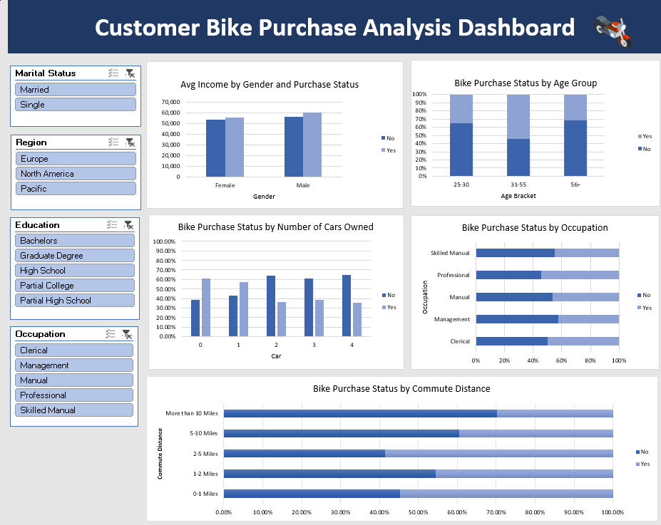

# Customer Bike Purchase Analysis

## Project Overview

This project uses Microsoft Excel to explore customer characteristics associated with bike purchase decisions. The analysis focuses on purchase and non-purchase patterns across demographic and lifestyle groups.

The workbook includes data preparation, age-group transformation, PivotTable analysis, purchase-rate calculations, an interactive dashboard, and data-quality documentation.

## Dashboard Preview

## Project Objectives

- Prepare the supplied customer dataset for analysis.
- Examine purchase and non-purchase patterns across customer segments.
- Compare purchase rates between groups of different sizes.
- Explore how age group, occupation, commute distance, car ownership, gender, and income relate to the recorded purchase outcome.
- Present the analysis in an interactive Excel dashboard.
- Document data preparation steps, metric definitions, and dataset limitations.

## Tools and Excel Features

- Microsoft Excel
- PivotTables and PivotCharts
- Excel formulas
- Slicers and interactive filtering
- Data cleaning and standardisation
- Descriptive analysis and dashboard design

## Dataset and Source

- **Dataset name:** Bike Buyers
- **Original downloaded filename:** `Excel Project Dataset.xlsx`
- **Dataset source:** [Excel Project Dataset.xlsx](https://github.com/AlexTheAnalyst/Excel-Tutorial/blob/main/Excel%20Project%20Dataset.xlsx)

The dataset was downloaded from the public GitHub repository linked above. The original creator or publisher of the underlying data, collection methodology, and collection period were not identified in the available source materials. The dataset should therefore not be treated as independently verified or representative of the wider bicycle market.

**Dataset redistribution note:** The source repository did not provide a clearly identified reuse licence for the dataset when it was reviewed. This repository therefore references the original file rather than redistributing the raw dataset. The Excel workbook containing the full dataset is not included here.

## Data Preparation and Quality Checks

The supplied dataset contained **1,026 records** and **13 columns**.

The following preparation steps were recorded in the workbook:

- Identified and removed **26 exact duplicate rows**.
- Retained **1,000 records** in the cleaned worksheet.
- Checked the cleaned worksheet for blank cells; none were found.
- Checked customer identifiers; the cleaned worksheet contains **1,000 unique customer IDs**.
- Standardised gender values (`M` to `Male`, `F` to `Female`).
- Standardised marital-status values (`M` to `Married`, `S` to `Single`).
- Created age groups: **25–30**, **31–55**, and **56+**.

These checks describe the operations performed on the supplied file. They do not independently establish the accuracy or authenticity of the original records.

## Analysis and Dashboard

The Excel dashboard presents five analysis areas:

1. **Average income by gender and purchase status** — compares the dataset's income values for customers marked `Yes` and `No` across gender groups. The income unit and currency are not confirmed in the source.
2. **Bike purchase status by age group** — compares the proportions of purchasing and non-purchasing customers across the three age groups.
3. **Bike purchase status by number of cars owned** — compares purchase and non-purchase proportions across car-ownership groups.
4. **Bike purchase status by occupation** — compares purchase and non-purchase proportions across occupation categories.
5. **Bike purchase status by commute distance** — compares purchase and non-purchase proportions across commute-distance categories.

Dashboard slicers allow the user to explore the results by available customer attributes, including marital status, region, education, and occupation.

## Selected Findings

The following figures were calculated from the 1,000-record cleaned worksheet. They are descriptive results for this dataset only.

### Overall purchase outcome

- Customers marked as purchasing a bike (`Yes`): **481 (48.1%)**.
- Customers marked as not purchasing a bike (`No`): **519 (51.9%)**.

### Age group

| Age group | Customers | Purchased (`Yes`) | Purchase rate |
|---|---:|---:|---:|
| 25–30 | 110 | 39 | 35.45% |
| 31–55 | 719 | 388 | 53.96% |
| 56+ | 171 | 54 | 31.58% |

The 31–55 group has the highest purchase rate in this dataset. It is also the largest age group, so both group size and purchase rate should be considered when interpreting the result.

### Occupation

| Occupation | Customers | Purchased (`Yes`) | Purchase rate |
|---|---:|---:|---:|
| Clerical | 177 | 88 | 49.72% |
| Management | 173 | 73 | 42.20% |
| Manual | 119 | 55 | 46.22% |
| Professional | 276 | 150 | 54.35% |
| Skilled Manual | 255 | 115 | 45.10% |

The Professional group has the highest observed purchase rate among the occupation categories.

### Commute distance

| Commute distance | Customers | Purchased (`Yes`) | Purchase rate |
|---|---:|---:|---:|
| 0–1 miles | 366 | 200 | 54.64% |
| 1–2 miles | 169 | 77 | 45.56% |
| 2–5 miles | 162 | 95 | 58.64% |
| 5–10 miles | 192 | 76 | 39.58% |
| More than 10 miles | 111 | 33 | 29.73% |

The 2–5 mile group has the highest observed purchase rate; the more-than-10-mile group has the lowest.

### Number of cars owned

| Cars owned | Customers | Purchased (`Yes`) | Purchase rate |
|---:|---:|---:|---:|
| 0 | 247 | 151 | 61.13% |
| 1 | 267 | 152 | 56.93% |
| 2 | 342 | 124 | 36.26% |
| 3 | 85 | 33 | 38.82% |
| 4 | 59 | 21 | 35.59% |

Customers recorded as owning zero or one car have higher purchase rates in this dataset than those recorded as owning two or more cars. The four-car group contains only 59 records, so its rate should be interpreted with that group size in mind.

## Metric Definitions

- **Total customers in a group:** Number of customer records within the selected segment.
- **Purchasing customers:** Count of records where `Purchased Bike = Yes`.
- **Non-purchasing customers:** Count of records where `Purchased Bike = No`.
- **Purchase rate:** Purchasing customers divided by total customers in the group, multiplied by 100.
- **Non-purchase rate:** Non-purchasing customers divided by total customers in the group, multiplied by 100.
- **Average income:** Average of the `Income` values in the relevant group. The dataset does not confirm the currency or measurement period.

## Workbook Structure

The working Excel file is organised into these worksheets:

| Worksheet | Purpose |
|---|---|
| `bike_buyers` | Original imported dataset |
| `Working_Sheet` | Cleaned data and age-group field |
| `Pivote_Table` | Supporting PivotTables and calculations |
| `Dashboard` | Interactive charts and slicers |
| `Data_Quality_Notes` | Source details, cleaning checks, metric definitions, and limitations |

## Limitations

- The original publisher or creator of the underlying data could not be identified from the available source materials.
- The collection methodology and collection period are not documented.
- The currency and measurement period for the `Income` field are not confirmed.
- Findings describe patterns within this 1,000-record dataset and should not be generalised to all bicycle customers or the wider bicycle market.
- The observed relationships are descriptive and do not establish causation.
- Removing exact duplicate rows and finding no blank cells does not prove that the remaining records are accurate or independently verified.

